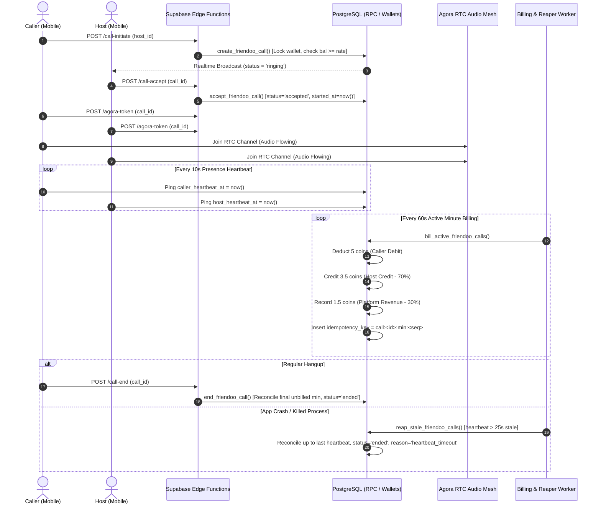

# Engineering Review & Technical Specification
## Friendoo Real-Time Billing State Machine & Agora WebRTC Architecture

**Review Date:** August 20, 2026  
**Status:** LOCKED & APPROVED FOR VALIDATION  
**Target:** 48-Hour Paid Beta Test (5 Hosts, 20 Paid ₹50 Calls)  

---

## 1. System Architecture & Double-Entry Ledger Flow



---

## 2. Core State Machine Invariants & Ledger Rules

### 1. Authoritative Server Calculations (Zero Client Trust)
- **Duration Calculation:** Elapsed call time is measured strictly on the server: `v_duration_sec = extract(epoch from now() - v_call.started_at)::integer`.
- **5-Second Grace Period Rule:**
  - If `v_duration_sec <= 5`: **0 coins deducted**, **0 coins credited**. Marked `end_reason = 'grace_period'`. (Protects callers against immediate silent drops or accidental taps).
  - If `v_duration_sec > 5`: Total billed minutes = `ceil(v_duration_sec / 60.0)::integer`.
- **Reconciliation at Call End (`end_friendoo_call`):**
  - Calculates `v_unbilled_minutes = v_total_minutes - v_call.billed_minute_count`.
  - Executes immediate atomic debit/credit for remaining fractional minutes so callers are never under-billed and hosts are never under-paid upon hangup.

### 2. Configurable Revenue Split Ledger Model
- **Configurable Split Rule:** Dynamic configuration stored in `system_configs` (`host_revenue_share_pct = 0.70`), never hardcoded.
- **Double-Entry Journal Entry per Minute:**
  1. **Caller Debit:** `-5.00` coins (`wallet_transactions.type = 'debit'`, `balance_after = new_balance`).
  2. **Host Credit:** `+3.50` coins (`wallet_transactions.type = 'credit'`, `balance_after = host_new_balance`).
  3. **Platform Retained Earnings:** `+1.50` coins recorded in `platform_revenue_ledger` with reference to `call_id` and `minute_seq`.

### 3. Deterministic Idempotency Key
- Idempotency format: `call:<call_id>:min:<minute_sequence_number>` (e.g. `call:9b1deb4d:min:1`, `call:9b1deb4d:min:2`).
- Guaranteed unique constraint on `wallet_transactions(idempotency_key)`.
- Eliminates risk of double-billing from network retries, cron overlaps, or concurrent hangup events.

### 4. Heartbeat Timeout & Zombie Call Reaper
- Mobile apps send heartbeat pings every **10 seconds** updating `calls.caller_heartbeat_at` and `calls.host_heartbeat_at`.
- Reaper function `reap_stale_friendoo_calls()` runs every **15 seconds**:
  - Identifies active calls where `now() - greatest(caller_heartbeat_at, host_heartbeat_at) > interval '25 seconds'`.
  - Reconciles duration up to the **last valid heartbeat timestamp** (ensuring the user is not charged for dead network time).
  - Marks call `ended` with `end_reason = 'heartbeat_timeout'` and resets presence to `online`.

---

## 3. Comprehensive QA Test Matrix & Failure Scenarios

```
========================================================================================================================
TEST SCENARIO                  TRIGGER / ACTION                       EXPECTED SERVER-AUTHORITATIVE BEHAVIOR
========================================================================================================================
1. Happy Path (3 min call)     Caller & Host talk for 180s,           - Min 1: Caller debited 5, Host credited 3.5
                               then hang up.                          - Min 2: Caller debited 5, Host credited 3.5
                                                                      - Min 3: Caller debited 5, Host credited 3.5
                                                                      - Total: 15 coins caller debit, 10.5 host credit
------------------------------------------------------------------------------------------------------------------------
2. 5-Second Grace Period       Caller connects, hears bad audio or    - Duration: 4s <= 5s.
   Cancellation                silence, hangs up in 4 seconds.        - 0 coins debited, 0 coins credited.
                                                                      - Call marked 'ended' with end_reason='grace_period'.
------------------------------------------------------------------------------------------------------------------------
3. Mid-Minute Hangup           Caller talks for 75 seconds (1 min     - Min 1 billed in real-time (5 caller / 3.5 host).
   (Ceil / Minute boundary)    15 sec) and hangs up.                  - Hangup triggers final reconciliation for min 2.
                                                                      - Total: 2 minutes charged (10 caller / 7.0 host).
------------------------------------------------------------------------------------------------------------------------
4. Sudden App Kill / Crash     Caller terminates app process or phone - No client `call-end` packet arrives.
   (Heartbeat Reaper)          dies at 2m 10s.                        - Reaper detects heartbeat > 25s stale at 2m 35s.
                                                                      - Reconciles call strictly to 2m 10s (last heartbeat).
                                                                      - Caller billed exactly 3 minutes, not drained to 0.
------------------------------------------------------------------------------------------------------------------------
5. Network Drop & Reconnect    Caller experiences temporary cellular  - Agora audio auto-reconnects within 15s.
   (Within 20s window)         handover (WiFi -> 4G) for 8 seconds.   - Heartbeat resumes before 25s reaper deadline.
                                                                      - Call remains 'active', billing continues smoothly.
------------------------------------------------------------------------------------------------------------------------
6. Wallet Balance Exhaustion   Caller has only 12 coins (rate=5/min). - Min 1: 12 - 5 = 7 coins remaining (Call active).
   (Mid-Call Auto-Disconnect)  At minute 3, balance is 2 (< 5 coins).  - Min 2: 7 - 5 = 2 coins remaining (Warning sent).
                                                                      - Min 3: Balance 2 < 5 -> Server terminates call.
                                                                      - Reason: 'insufficient_coins', presence -> online.
------------------------------------------------------------------------------------------------------------------------
7. Duplicate / Out-of-Order    Network retries send duplicate         - Idempotency key `call:<id>:min:<seq>` deduplicates.
   Billing Events              `bill_active_friendoo_calls` RPCs.     - ON CONFLICT DO NOTHING prevents double-debit.
------------------------------------------------------------------------------------------------------------------------
8. Host Decline / Timeout      Host ignores or declines incoming call - Caller presence reset from 'busy' -> 'online'.
   (Zero Balance Impact)       after ringing for 30s.                 - 0 coins debited. Status = 'missed' / 'rejected'.
========================================================================================================================
```

---

## 4. 48-Hour Paid Validation Execution Plan

1. **Host Cohort (5 Beta Hosts):**
   - 2 Hindi Hosts (Evening & Late Night)
   - 2 English / Hinglish Hosts
   - 1 Regional Host (Telugu / Tamil / Marathi)
2. **Paid Call Volume:**
   - 20 paid test calls funded via real ₹50 Cashfree wallet topups.
   - Monitor real-time transaction ledger in Bento Ops CRM (`/crm/revenue`).
3. **Primary Validation Metric:**
   - **Same-Host 48-Hour Re-call Rate:** Count of unique callers who initiate a 2nd paid voice session with the same host within 48 hours without prompting.
