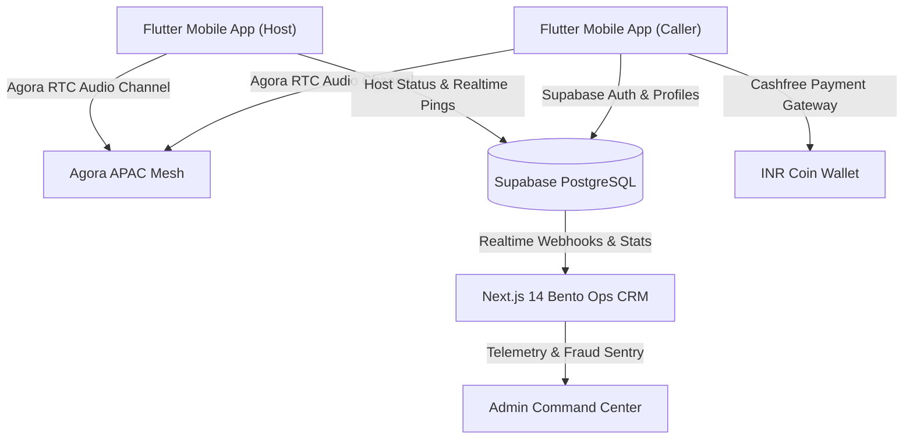

# Design: Friendoo Voice Companion Launch Wedge

**Generated by `/office-hours` on August 20, 2026**  
**Repo:** `friendoo`  
**Status:** APPROVED (DRAFT FOR REVIEW)  
**Mode:** Startup Mode  

---

## 1. Problem Statement
In urban India and Tier 2/3 hubs, millions of young professionals and relocated workers experience severe late-night emotional isolation after long work shifts. Existing solutions either require high-friction dating commitments (Tinder/Bumble where 90% of messages go unanswered) or force users into risky, informal gray-market transactions on Telegram and Instagram with zero payment safety or privacy protection.

Meanwhile, thousands of articulate, empathetic individuals (college students, voice artists, homemakers) want dignified, flexible micro-earnings from home but cannot risk sharing their personal phone numbers or identity online.

---

## 2. Demand Evidence
- **Existing Gray-Market Volume:** Users are already manually sending UPI transfers via screenshots to informal hosts on Instagram/Telegram for 1-on-1 audio calls, enduring constant payment fraud and scam risks.
- **Supply-Side Pull:** Aspiring voice hosts are eager to join platforms that offer guaranteed minute-by-minute wallet escrow with anonymous avatar privacy.
- **Willingness to Pay:** Voice companionship carries strong utility and urgency at late hours (10 PM – 2 AM), commanding ₹5–₹10/minute talk rates.

---

## 3. Status Quo & The Broken Workaround
1. **Manual UPI + Telegram/WhatsApp Audio:** Users send upfront money, hosts risk non-payment or harassment, and real phone numbers are exposed.
2. **Dating & Matrimony Apps:** Expensive monthly subscriptions, superficial swiping games, days of waiting for replies when the user needs to talk *right now*.
3. **Public Audio Rooms (Clubhouse/ShareChat):** Broadcasting to dozens of listeners fails to provide private, 1-on-1 attentive listening.

---

## 4. Target User & Narrowest Wedge

### Primary Paying Persona: The Late-Night Isolated Urban Worker (Age 23–32)
- **Profile:** Software engineer, BPO associate, or small business founder living away from hometown in Bangalore, Pune, Hyderabad, or Delhi NCR.
- **Trigger:** Returning to an empty apartment at 11:30 PM, mentally exhausted, needing genuine empathetic voice conversation without expectations or judgment.
- **Budget:** Willing to spend ₹150–₹500 per session (20–40 minutes).

### Primary Supply Persona: The Verified Voice Host (Age 20–26)
- **Profile:** Empathetic speaker, student, or voice talent seeking ₹15,000–₹40,000/month in home income.
- **Core Requirement:** 100% anonymous audio calling (Agora tunnel), automated coin balance deduction per 60 seconds, and 1-click Cashfree UPI bank withdrawal.

### The Narrowest Wedge (Approach A)
- **The 48-Hour Launch Loop:** 
  1. User installs Flutter app & registers via phone OTP.
  2. User selects an online Star Host with real-time audio sample.
  3. Agora RTC establishes private 1-on-1 audio channel in <500ms.
  4. Real-time coin ticker decrements balance (e.g. 5 coins/min) with automated grace-period warning.
  5. Host receives instant earnings credit; Admin verifies telemetry on the Next.js Bento CRM matrix.

---

## 5. System Architecture & Technical Stack

- **Frontend Mobile App (`flutter_app`):** Flutter + Riverpod + `supabase_flutter` + `agora_rtc_engine` + Cashfree SDK. Maximalist neon gradient UI with tactile haptic controls.
- **Backend & Database:** Supabase PostgreSQL with Realtime subscriptions, row-level security (RLS), and automated minute billing triggers.
- **Audio Infrastructure:** Agora APAC RTC mesh with low-latency WebRTC routing.
- **Operations & Intelligence Portal (`crm`):** Next.js 14 App Router Bento Grid Matrix with real-time WebRTC diagnostics, revenue intelligence, host queue approvals, and fraud sentry.

---

## 6. The Assignment (Next Action)
1. **Onboard First 5 Curated Hosts:** Recruit 5 high-empathy beta hosts across Hindi, English, and Telugu with recorded 10-second voice bios.
2. **Execute 20 Paid Test Calls:** Run 20 end-to-end voice calls with real Cashfree ₹50 wallet topups to verify latency, escrow precision, and host payout reconciliation.
3. **Verify Day-1 Retention:** Measure how many callers initiate a second call with their favorite host within 48 hours.

---

## 7. Next GStack Skills Pipeline
- Run `/plan-ceo-review` or `/plan-eng-review` to lock in the technical execution plan.
- Run `/qa` to test live WebRTC audio and wallet flows before launch.
- Run `/ship` to land production release.
