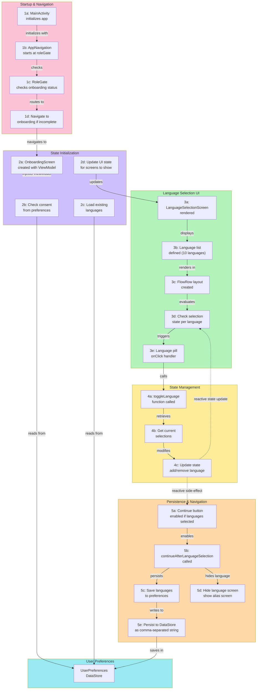

# Onboarding — Language Selection Flow

Verified against actual codebase on 2026-05-12.
All node references map to real file locations.

## Flow Diagram



## Code References

| Node | File | Line(s) | Description |
|------|------|---------|-------------|
| 1a | `presentation/MainActivity.kt` | 30–36 | Initializes `AppNavigation` |
| 1b | `presentation/Navigation.kt` | 41 | `startDestination = "roleGate"` |
| 1c | `presentation/Navigation.kt` | 170–175 | `RoleGate` checks `onboardingCompleted` |
| 1d | `presentation/Navigation.kt` | 170–175 | Routes to `onboarding` if incomplete |
| 2b | `onboarding/OnboardingViewModel.kt` | 35–47 | `init` reads `consentGivenFlow` |
| 2c | `onboarding/OnboardingViewModel.kt` | 35–47 | `init` reads `preferredLanguagesFlow` |
| 2d | `onboarding/OnboardingScreen.kt` | 45–51 | Renders screen based on state flags |
| 3a | `onboarding/OnboardingScreen.kt` | 45–51 | `LanguageSelectionScreen` rendered |
| 3b | `onboarding/OnboardingScreen.kt` | 79 | 10-language list defined |
| 3c | `onboarding/OnboardingScreen.kt` | 116 | `FlowRow` layout |
| 3d | `onboarding/OnboardingScreen.kt` | 122–124 | Selection check per pill |
| 3e | `onboarding/OnboardingScreen.kt` | 122–124 | `Surface(onClick)` handler |
| 4a | `onboarding/OnboardingViewModel.kt` | 57–62 | `toggleLanguage()` called |
| 4b | `onboarding/OnboardingViewModel.kt` | 57–62 | Gets current `selectedLanguages` |
| 4c | `onboarding/OnboardingViewModel.kt` | 57–62 | Adds or removes language from set |
| 5a | `onboarding/OnboardingScreen.kt` | 143–147 | Continue button enabled check |
| 5b | `onboarding/OnboardingViewModel.kt` | 64–69 | `continueAfterLanguageSelection()` |
| 5c/5e | `data/local/UserPreferences.kt` | 110–114 | Comma-separated save to DataStore |
| 5d | `onboarding/OnboardingViewModel.kt` | 64–69 | Sets `showLanguageScreen = false` |

## Diagram Notes

- The `4c → 5a` edge is a **reactive side-effect**, not a direct call.
  The language pill `onClick` only calls `toggleLanguage()`.
  The Continue button enabling is driven by `selectedLanguages.isNotEmpty()` recomposing reactively.
  This is shown as a dashed edge in the diagram above.
- The `OnboardingScreen` falls through to `AliasSelectionScreen` once `showLanguageScreen` becomes `false`.
  See `OnboardingScreen.kt` lines 49–50.

## Onboarding Screen Flow

```
Login / OTP
    │
    ▼
RoleGate (Navigation.kt)
    │ onboardingCompleted == false
    ▼
OnboardingScreen
    ├── showConsentScreen == true  →  ConsentScreen
    ├── showLanguageScreen == true →  LanguageSelectionScreen  ← THIS FILE
    └── else                       →  AliasSelectionScreen
```

## Related Files

- `Friendoo/app/src/main/java/com/friendoo/app/presentation/onboarding/OnboardingScreen.kt`
- `Friendoo/app/src/main/java/com/friendoo/app/presentation/onboarding/OnboardingViewModel.kt`
- `Friendoo/app/src/main/java/com/friendoo/app/data/local/UserPreferences.kt`
- `Friendoo/app/src/main/java/com/friendoo/app/presentation/Navigation.kt`
- `Friendoo/app/src/main/java/com/friendoo/app/presentation/MainActivity.kt`
